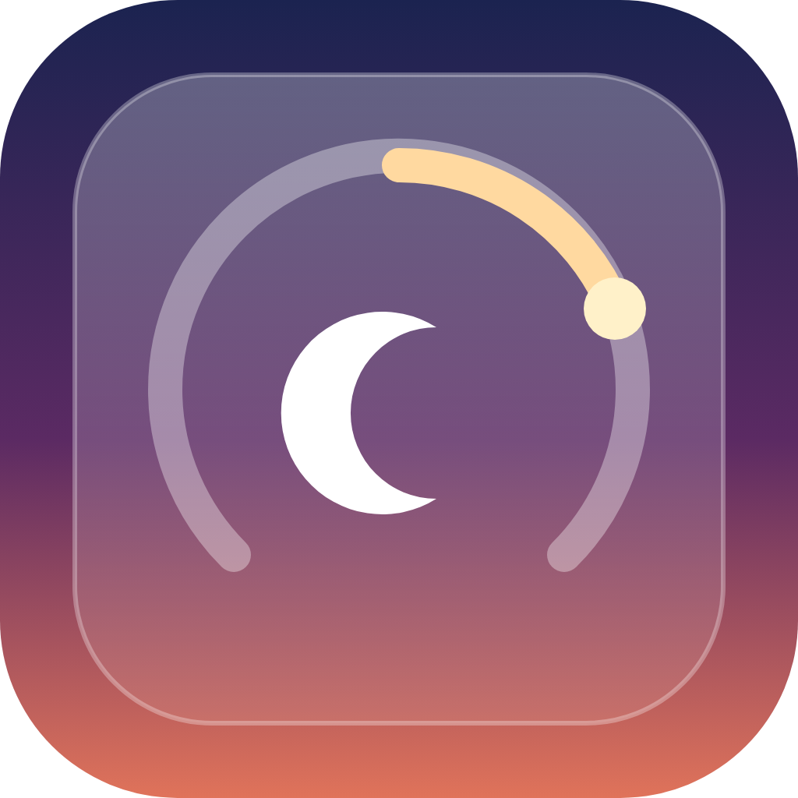

<p align="center"></p>

<h1 align="center">Fasila · فاصلة</h1>
<p align="center"><b>Plan your day around prayer, not the clock.</b></p>

Most calendars and to-do apps were designed without the five daily prayers in
mind. A meeting set for "17:30" is in Maghrib in December and in Asr in June, so
prayers get squeezed, delayed or missed.

Fasila turns that around. You schedule **relative to prayers**, and the five
prayers are protected time that nothing else is allowed to take:

* *"Wake me 15 min before Fajr"*
* *"Meeting 30 min after Asr for 1 hour"*
* *"اجتماع بعد العصر بنصف ساعة لمدة ساعة"*
* *"Réunion 30 min après Asr jusqu'à 10 min avant Maghrib"*
* *"Leave home 45 min before Jumu'ah"*, *"Suhoor alarm 30 min before Imsak during Ramadan"*

Items move with the sun every day. If something would cover a prayer's protected
time, Fasila warns you and suggests the nearest free gap. Fāṣila means "the
interval".

## What's inside

| Path | What | Tech |
|------|------|------|
| `crates/fasila-core` | Prayer times, Hijri calendar, scheduling engine, parser. The single source of truth. | Rust, zero dependencies |
| `crates/fasila-ffi` | The same core for Swift and Kotlin | UniFFI |
| `crates/fasila-cli` | `fasila` command line with JSON output, for scripts and AI agents | Rust |
| `apps/desktop` | Windows & Linux app with tray and background notifications | Tauri 2 + Svelte 5 |
| `apps/apple` | iOS & macOS app | SwiftUI |
| `apps/android` | Android app | Kotlin + Jetpack Compose |

Every platform calls the same Rust code, so Fajr in Algiers is identical to the
second on a phone, a laptop and in the CLI.

## Accuracy

* Meeus solar model with nutation, aberration and ΔT. Every event is solved at its
  own instant, not from a noon approximation.
* **Checked against the Astropy/ERFA ephemeris: worst error 2.1 seconds** over 13
  cities × 5 dates (`tools/verify`).
* 20 calculation methods with sources, plus Hanafi/Standard Asr, high-latitude
  and polar rules, and precautionary rounding (a prayer is never shown early).
* Hijri: official Umm al-Qura table, a tabular calendar, ±day adjustment, and a
  **per-country feed of official moon-sighting announcements** that overrides the
  base calendar.

See [docs/ACCURACY.md](docs/ACCURACY.md).

## Design

The whole app sits on a dark **living sky**: a 4-stop gradient that blends from
first light to night, pinned to the day's real prayer times, with 45 twinkling
stars that fade out at dawn and return after Maghrib. Content sits on subtle glass
with a single highlight line along the top edge. Today's hero is a **celestial
scene**: the sun moves along its arc from sunrise to Maghrib, with Dhuhr and Asr
marked on it. At night the moon appears in its real, computed phase, together with
the Hijri lunar day and the White Days. Arabic is first-class: RTL layouts,
Tajawal type and the digits used in your region (Western in the Maghreb,
Arabic-Indic in the Mashriq). See [docs/DESIGN.md](docs/DESIGN.md).

## Quick start

```bash
# Core + CLI
cargo test
cargo run -p fasila-cli -- --lat 36.7538 --lon 3.0588 --country DZ --utc-offset 60 --text times --days 7
cargo run -p fasila-cli -- --text parse "meeting 30 min after asr for 1 hour"

# Desktop (Linux deps: libwebkit2gtk-4.1-dev libayatana-appindicator3-dev librsvg2-dev)
cd apps/desktop && npm install && npm run tauri dev
npm run tauri build            # .deb/.rpm/.AppImage on Linux, .msi/.exe on Windows

# Mobile
./scripts/build-apple.sh       # then see apps/apple/README.md
./scripts/build-android.sh     # then see apps/android/README.md
```

## For agents and scripts (AX)

`fasila` prints stable JSON (unix timestamps and ISO UTC). Exit code 2 means bad
input and 3 means a sentence it could not parse:

```bash
fasila --lat 21.4225 --lon 39.8262 next
fasila --config ~/.config/fasila.json schedule items.json --days 7   # occurrences + prayer conflicts
fasila --lat 51.5 --lon -0.12 --country GB slots --minutes 90        # free time that touches no prayer
fasila hijri 1448-09-01 --from-hijri                                 # when does Ramadan start?
```

The configuration and item files use the same JSON schema in every app (see
`crates/fasila-core/src/config.rs` and `schedule.rs`).

## Contributing Hijri announcements

When your country's religious authority announces the start of a month, add it to
[`data/hijri/announcements.json`](data/hijri/announcements.json) with the source.
Every app picks it up on its next refresh.

## License

MIT. The Umm al-Qura month table comes from `hijri-converter` © Mohammed Alshehri (MIT).
